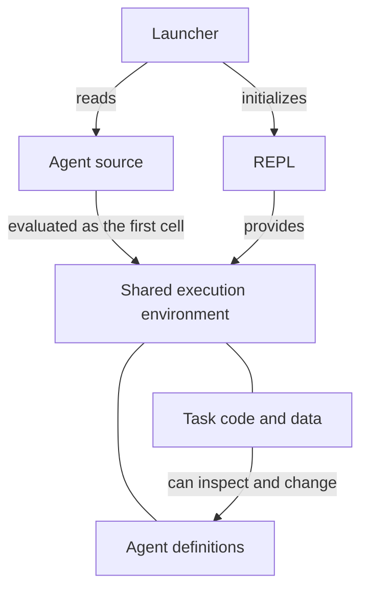

# Project design: REPL and agent

The project places an agent inside the execution environment it uses for work. The REPL provides that environment; the agent runs as code within it. Later code can inspect and change the agent through the same bindings and objects it uses for ordinary tasks.

This relationship separates the mechanics of executing code from the policies that decide what to do. It also makes those policies accessible to the agent itself.

## Responsibilities

| Part | Responsibility |
| --- | --- |
| REPL | Keep a language execution environment available across cells, with shared bindings, source history and nested asynchronous execution |
| Agent | Run within that environment and decide how to perform the user's task |
| Launcher | Initialize a REPL environment, evaluate the agent source and close the REPL when execution ends |

The REPL has no knowledge of models, prompts, conversation history or recovery modes. Those concepts belong to the agent. The agent relies on the REPL to execute source and preserve its environment, without requiring the REPL to interpret that source as an agent-specific protocol.

## How they connect

Before evaluating the agent, the REPL exposes two capabilities to the code running inside it:

- Raw execution of another cell in the same environment.
- Access to submitted source, including the source currently being evaluated.

The complete agent source is evaluated as the first cell. It can define functions and variables, retain the raw executor, read its own source and begin work. Subsequent cells share this namespace, so they can use both task data and agent definitions.

The first cell can remain active while the agent works. When it awaits another cell, execution is nested within the same REPL. That cell finishes before its caller continues. This allows the agent's own code and the code it requests to run together without a second orchestration loop in the host.

## Startup and lifetime

Each language directory contains one REPL and one agent. Its launcher initializes the REPL environment and evaluates the agent source from the same directory once. The source controls its own initialization and entry into work. The launcher does not need to know a particular agent function name or interpret an agent return value.

When evaluation ends, normally or through an error, the launcher closes REPL-owned resources. Resources acquired by agent code belong to the agent and are released as that code exits.

## Shared access and its consequences

The agent and task code share a namespace and process. Replacing a definition can affect subsequent agent calls; modifying a shared object can affect code that still holds a reference to it. Source history and current definitions may differ after such changes.

The complete agent remains available as evaluated source. Libraries can supply facilities such as networking or storage, while the agent's own policies stay visible in the environment. This is what allows the agent to inspect and change how it works.

Shared execution also means shared failure. Blocking or terminating the process affects the agent itself, and code changes do not undo external actions. The REPL provides execution continuity and error propagation; how the agent uses them to recover or improve its behavior belongs to its own design.

## Two levels of design

[REPL design](repl.md) describes persistent bindings, nested execution, errors and cleanup. [Agent design](agent/README.md) describes what runs on that foundation: model access, task state, Session, Context, work, recovery and self-modification.

Different language versions provide the same relationship between these two parts through their own execution facilities.
